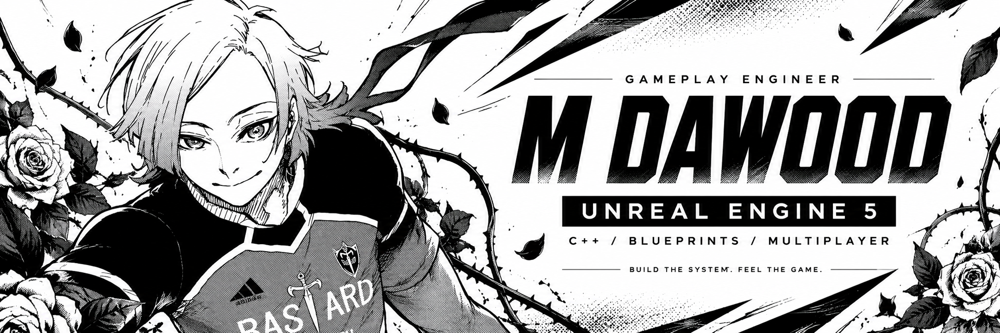

<!-- Upload README.md and the entire assets folder to your username repository. -->

  

<samp>UNREAL ENGINE DEVELOPER &nbsp; / &nbsp; SOFTWARE ENGINEER &nbsp; / &nbsp; LAHORE, PAKISTAN</samp>

<a href="#systems">SYSTEMS</a> &nbsp; / &nbsp; <a href="#journey">EXPERIENCE</a> &nbsp; / &nbsp; <a href="#contact">CONNECT</a>

 

<table>
  <tr>
    <td width="60%" valign="top">
      <h3>THE DEVELOPER BEHIND THE GAME</h3>
      
I'm <b>Dawood</b>, an Unreal Engine 5 developer building polished PC and mobile game experiences with <b>C++ and Blueprints</b>.

      
I work across gameplay, combat, multiplayer, AI, interfaces, and optimization — connecting the technical systems to how a game feels in a player's hands.

    </td>
    <td width="40%" valign="top">
      <h3>AT A GLANCE</h3>
      
<b>ROLE</b> Software Engineer · GenITeam Solutions

      
<b>FREELANCE</b> Fiverr Level 2 Seller · 25+ completed game development projects

      
<b>PLATFORMS</b> PC &amp; Mobile

    </td>
  </tr>
</table>

 

  
  
  
  
  
  

 

<table>
  <tr>
    <td width="50%" valign="top"><h3>GAMEPLAY / COMBAT</h3>
Weapon mechanics, player movement, combat flow, and responsive gameplay interactions.
</td>
    <td width="50%" valign="top"><h3>MULTIPLAYER / AI</h3>
Replication, matchmaking logic, network synchronization, and gameplay AI behavior.
</td>
  </tr>
  <tr>
    <td width="50%" valign="top"><h3>INTERFACES / INTEGRATIONS</h3>
Game UI/UX, SDK integrations, ads, in-app purchases, and analytics.
</td>
    <td width="50%" valign="top"><h3>PERFORMANCE / DELIVERY</h3>
PC and mobile optimization, prototypes, full-cycle development, project planning, and client coordination.
</td>
  </tr>
</table>

 

<blockquote>
  
<b>SOFTWARE ENGINEER · GenITeam Solutions</b> <samp>MAR 2026 — PRESENT</samp>

  
Unreal Engine development alongside end-to-end project delivery. Gameplay systems, multiplayer, AI, combat, performance optimization, client requirements, and team coordination.

</blockquote>

<blockquote>
  
<b>UNREAL ENGINE DEVELOPER · Fiverr</b> <samp>JAN 2025 — PRESENT</samp>

  
Level 2 Seller with 25+ completed game development projects. PC and mobile gameplay programming, multiplayer, AI, UI/UX, integrations, and development from prototype to release.

</blockquote>

  
<b>EARLIER CHAPTERS — Venzo Labs &amp; Dev Cynx</b>

  <h4>Game Developer · Venzo Labs</h4>
  
<samp>JAN — FEB 2026</samp>

  
Contributed to a multiplayer mobile FPS in UE5: weapons, movement, combat flow, replication, matchmaking logic, and network synchronization.

  <h4>Junior Game Developer · Dev Cynx</h4>
  
<samp>JAN 2025 — JAN 2026</samp>

  
Worked on 2D/3D PC games, gameplay mechanics, UI/UX with Blueprints and C++, and SDK integrations for ads, in-app purchases, and analytics.

  
<b>EDUCATION — Computer Science</b>

  
Bachelor's degree in Computer Science · Minhaj University Lahore · 2020–2024

 

<h3 align="center">LET'S BUILD SOMETHING PLAYABLE.</h3>

Unreal Engine gameplay · Multiplayer experiences · Game prototypes

<b><a href="https://www.linkedin.com/in/m-dawood-9b8a39274/">CONNECT WITH ME ON LINKEDIN ↗</a></b>

 

