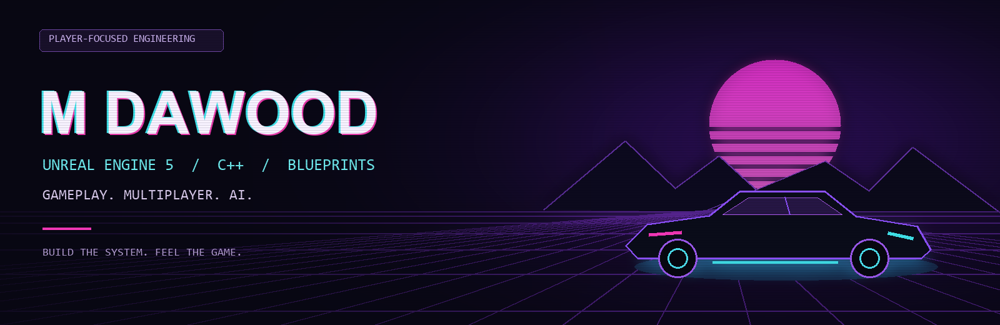

  

<h1 align="center">Hey, I'm Dawood.</h1>

<b>Unreal Engine Developer · Software Engineer · Lahore, Pakistan</b>

I build responsive gameplay, connected worlds, and systems that feel good to play.

  
  

---

### `01 / ABOUT THE DEVELOPER`

I'm an Unreal Engine 5 developer working with **C++ and Blueprints** to turn game ideas into polished PC and mobile experiences. My work covers gameplay programming, multiplayer systems, AI behavior, combat mechanics, UI/UX, SDK integration, and performance optimization.

At **GenITeam Solutions**, I combine hands-on Unreal development with project planning, client communication, and delivery coordination. I also work as a freelance Unreal Engine developer on Fiverr, where I've completed **25+ game development projects** as a **Level 2 Seller**.

### `02 / THE TOOLKIT`

  
  
  
  
  
  

| System | What I work on |
| :--- | :--- |
| **Gameplay & combat** | Weapon mechanics, player movement, combat flow, and responsive interactions |
| **Multiplayer** | Replication, matchmaking logic, and network synchronization |
| **AI behavior** | Gameplay AI and interactions that support engaging player experiences |
| **UI & integrations** | Game interfaces, ads, in-app purchases, analytics, and SDK integration |
| **Performance & delivery** | PC/mobile optimization, prototypes, and full-cycle development |

### `03 / EXPERIENCE LOG`

| Role | Team | Timeline |
| :--- | :--- | :--- |
| **Software Engineer** | GenITeam Solutions | Mar 2026 – Present |
| **Unreal Engine Developer** | Fiverr · Freelance | Jan 2025 – Present |
| **Game Developer** | Venzo Labs | Jan – Feb 2026 |
| **Junior Game Developer** | Dev Cynx | Jan 2025 – Jan 2026 |

At **Venzo Labs**, I contributed to a multiplayer mobile FPS in UE5, working on weapons, movement, combat flow, replication, and network synchronization. At **Dev Cynx**, I worked on 2D/3D PC games, game mechanics, interfaces, and SDK integrations.

<b>Education</b>

**Bachelor's degree in Computer Science**  
Minhaj University Lahore · 2020–2024

### `04 / LET'S BUILD SOMETHING PLAYABLE`

Interested in collaborating on Unreal Engine gameplay, multiplayer experiences, or a game prototype? **[Let's connect on LinkedIn →](https://www.linkedin.com/in/m-dawood-9b8a39274/)**

---

BLUEPRINT THE IDEA. CODE THE FEEL. ITERATE THE EXPERIENCE.

